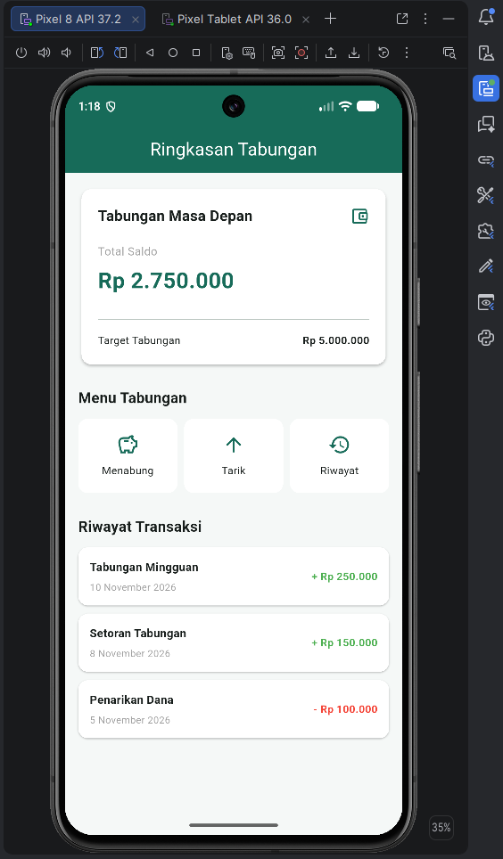
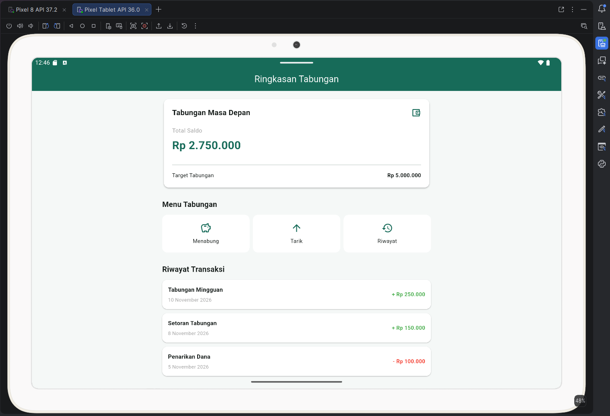

# TabungKu – Tugas Pertemuan Ke-3 Pemrograman Mobile

## Deskripsi Proyek

TabungKu merupakan aplikasi sederhana yang menampilkan informasi saldo dan target tabungan, menu kategori, serta riwayat transaksi menggunakan data statis. Tugas ini berfokus pada penyusunan tata letak (*layout*) halaman Ringkasan Tabungan menggunakan widget dasar Flutter.

 

## Identitas Mahasiswa

| Keterangan | Informasi                                                 |
|---|-----------------------------------------------------------|
| Nama | Iis Sumarni                                               |
| NIM | 20240801095                                               |
| Universitas | Universitas Esa Unggul                                    |
| Program Studi | Teknik Informatika                                        |
| Mata Kuliah | Pemrograman Mobile CR002                                  |
| Semester | 5                                                         |
| Tugas | Pertemuan 3 – Menyusun Layout dengan Widget Dasar Flutter |

## Fitur Tampilan

1. **Ringkasan Tabungan** – Menampilkan nama tabungan, total saldo, dan target tabungan.
2. **Menu Tabungan** – Menampilkan tiga kategori, yaitu Menabung, Tarik, dan Riwayat.
3. **Riwayat Transaksi** – Menampilkan tiga transaksi terakhir beserta judul, tanggal, dan nominal.
4. **Layout Responsif** – Menggunakan pengaturan tata letak agar nyaman ditampilkan pada layar HP dan tablet.

 **Catatan:** Aplikasi masih berfokus pada tampilan antarmuka. Data transaksi bersifat statis dan menu kategori belum memiliki fungsi interaktif.

## Widget Flutter yang Digunakan

| Widget | Fungsi |
|---|---|
| `MaterialApp` | Mengatur konfigurasi utama aplikasi dan tema. |
| `Scaffold` | Membentuk struktur dasar halaman. |
| `AppBar` | Menampilkan judul Ringkasan Tabungan. |
| `Card` | Menampilkan informasi tabungan dan transaksi. |
| `Column` dan `Row` | Mengatur susunan elemen secara vertikal dan horizontal. |
| `Container` | Mengatur tampilan serta batas lebar konten. |
| `Padding` dan `SizedBox` | Mengatur jarak antar elemen. |
| `Text` dan `Icon` | Menampilkan informasi dan ikon kategori. |
| `Expanded` | Membagi ruang agar susunan elemen lebih fleksibel. |
| `ListView` | Memungkinkan halaman digulir pada layar kecil. |

## Teknologi yang Digunakan

- **Framework:** Flutter
- **Bahasa Pemrograman:** Dart
- **IDE:** Android Studio
- **Pengujian:** Android Emulator (HP dan Tablet)
- **Version Control:** Git dan GitHub

## Hasil Tampilan Aplikasi

Berikut merupakan hasil implementasi halaman Ringkasan Tabungan pada dua ukuran layar yang berbeda.

### 1. Tampilan Mobile (HP)



### 2. Tampilan Tablet



## Cara Menjalankan Aplikasi

Buka terminal pada folder utama proyek dan jalankan:

```bash
flutter pub get
flutter run
```

Untuk memeriksa kode, jalankan:

```bash
flutter analyze
```

## Struktur Proyek

```text
tabungku_layout/
├── android/
├── lib/
│   └── main.dart
├── docs/
│   ├── tampilan_handphone.png
│   └── tampilan_tablet.png
├── pubspec.yaml
└── README.md
```

